<h1 align="center"></h1>

  &nbsp;
  &nbsp;
  

<h2 align="center"></h2>

  <strong>John Ray Cacananta</strong> — Full-Stack Developer · AI Security · Cloud · Automation 
  Quezon City, Philippines

<em>An agent should know what it's allowed to do before it does it.</em>

<h2 align="center"></h2>

- **AI agent security** — intent-based authorization, OPA/Rego, audit trails
- **Model Context Protocol** — wiring agents to tools safely
- **Full-stack builds** — Next.js · React · TypeScript · Supabase
- **Local-first AI** — Ollama, RAG, vector search
- **Automation** — n8n workflows, webhooks, agent orchestration

<h2 align="center"></h2>

<h2 align="center"></h2>

   
  A centralized operations platform for volunteer management, approvals, reporting, and AI-assisted knowledge retrieval. 
  <a href="https://github.com/Debb1ie/DEVCON-Kids-Hub-2.0">Repository</a> · <a href="https://devcon-kids-hub-2-0.vercel.app/">Live system</a>

   
  Causal Authorization and Governance Engine for AI agents, policy enforcement, and MCP security testing. 
  <a href="https://cage-agent-security.vercel.app/">Showcase</a>

   
  A campus marketplace with reservations, inventory management, authentication, admin workflows, and AI assistance. 
  <a href="https://github.com/sinagdevv/bulldogs-xchange">Repository</a> · <a href="https://bulldogs-xchange-live-demo.vercel.app/">Live demo</a>

   
  An AI-powered file intelligence and knowledge retrieval system designed around local-first workflows. 
  <a href="https://github.com/Gabi-comm/MAT-AH">Repository</a> · <a href="https://mat-ah-showcase.vercel.app/">Showcase</a>

   
  Fishermen safety and economic decision support with weather intelligence, risk assessment, and interactive maps. 
  <a href="https://github.com/Alvin187187/TripWise">Repository</a> · <a href="https://tripwise-sooty.vercel.app/">Live system</a>

   
  Cooking-oil quality monitoring using explainable decision logic and mathematical degradation models. 
  <a href="https://github.com/Gabi-comm/mantika-check">Repository</a> · <a href="https://mantika-check.vercel.app/">Live system</a>

<h2 align="center"></h2>

<h2 align="center"></h2>

<h2 align="center"></h2>

  &nbsp;
  &nbsp;
  

