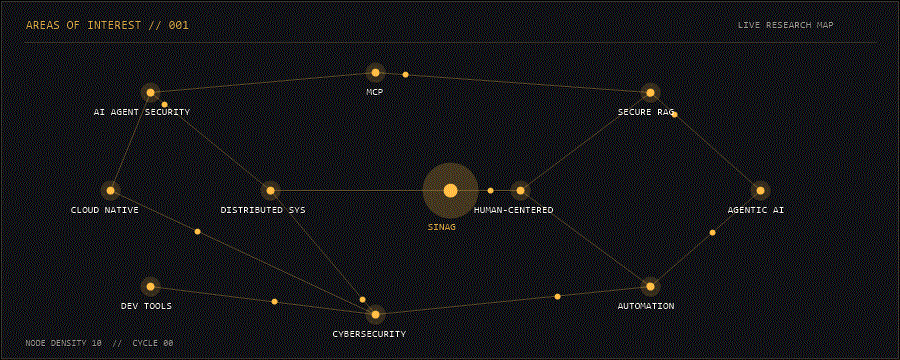
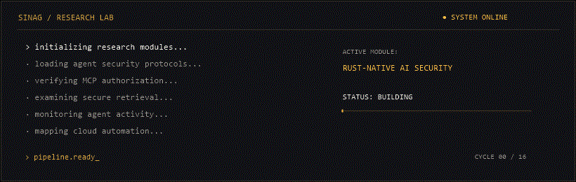

  

  

<strong>JOHN RAY CACANANTA</strong> <code>FULL-STACK DEVELOPER · AI SECURITY · CLOUD &amp; AUTOMATION</code>

  &nbsp;
  &nbsp;
  

## CAPABILITIES // STACK

  

  <strong><code>LANGUAGES</code></strong> 
  
  <code>SQL</code>

  <strong><code>FRONTEND</code></strong> 
  

  <strong><code>BACKEND</code></strong> 
  

  <strong><code>AI / ML</code></strong> 
  
  <code>OLLAMA</code>

  <strong><code>DATABASES</code></strong> 
  

  <strong><code>CLOUD / DEVOPS</code></strong> 
  

<strong><code>AUTOMATION</code></strong> <code>n8n</code>&nbsp; <code>POWER AUTOMATE</code>&nbsp; <code>API INTEGRATION</code>

<strong><code>AI SECURITY</code></strong> <code>MCP</code>&nbsp; <code>RAG</code>&nbsp; <code>AUTHORIZATION</code>&nbsp; <code>OPA</code>&nbsp; <code>REGO</code>&nbsp; <code>AGENT GOVERNANCE</code>

## AREAS OF INTEREST // 001

  

## CURRENTLY EXPLORING // ACTIVE

  

## ABOUT // 002

Second-year B.S. Information Technology student at National University - Fairview, working as an AI Automation Engineer Intern at AgentGenius.ai / KeywordGenius and a Data Innovation Track Intern at Eskwelabs. I build practical systems through hackathons, technical communities, and deliberate execution.

## SELECTED SYSTEMS // 003

### C.A.G.E. · causal authorization and governance engine

AI-agent security research focused on policy enforcement, authorization decisions, causal reasoning, and MCP security testing. <a href="https://cage-agent-security.vercel.app/"> Showcase</a>

### DEVCON Kids Hub 2.0 · operations and retrieval

Centralized volunteer operations, approvals, reporting, and AI-assisted knowledge retrieval. <a href="https://github.com/Debb1ie/DEVCON-Kids-Hub-2.0"> Repository</a> · <a href="https://devcon-kids-hub-2-0.vercel.app/"> Live system</a>

### Bulldogs Xchange · campus marketplace

Reservations, inventory, authentication, administrative workflows, and AI assistance in one campus workflow. <a href="https://github.com/sinagdevv/bulldogs-xchange"> Repository</a> · <a href="https://bulldogs-xchange-live-demo.vercel.app/"> Live demo</a>

SINAG /si·nag/ · a ray of light

