<div align="center">




<a href="https://www.linkedin.com/in/jrcacananta/"></a>
<a href="mailto:johnray.cacananta@gmail.com"></a>


</div>


## `> whoami`

```yaml
designation:  John Ray Cacananta
class:        Full-Stack Developer // AI Security // Cloud // Automation
base:         Quezon City, Philippines
core_belief:  an agent should know what it's allowed to do before it does it
status:       online and learning
```


## `> current_directives`

<table>
<tr>
<td width="50%" valign="top">

### 🤖 AI Automation Engineer Intern
**AgentGenius.ai / KeywordGenius** · *Oct 2026 – now*

- Building a Shopify-integrated app with **Next.js, React, TypeScript & Polaris**
- Hunting frontend ↔ backend integration bugs
- Working on **MCP integration** and **AI automation security**
- Shipping fixes through reviewed GitHub PRs

</td>
<td width="50%" valign="top">

### 📊 Data Innovation Track Intern
**Eskwelabs** · *Aug 2026 – now*

- Designing **synthetic, privacy-conscious datasets**
- Reproducible data generation with **Pandas & NumPy**
- Validation, statistical reasoning and EDA
- Documenting every assumption so the data stays honest

</td>
</tr>
</table>


## `> loaded_modules`

<div align="center">

#### 🧬 Languages


#### 🖥️ Frontend


#### ⚙️ Backend


#### 🗄️ Databases


#### 🧠 AI / ML
<br/>


#### 🛡️ AI Agents & Security


#### ☁️ Cloud & DevOps


#### 🔁 Automation


#### 🧰 Tools
<br/>


</div>


## `> telemetry`

<div align="center">


</div>

<div align="center">


</div>
