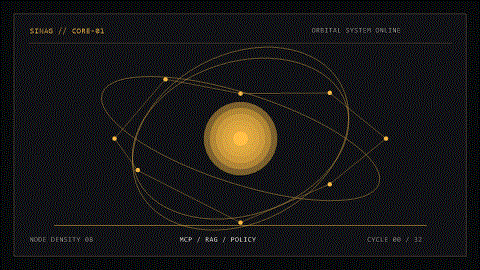
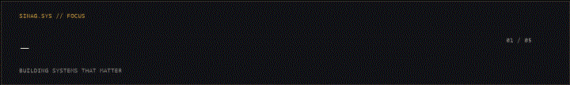

  

  

<strong>JOHN RAY CACANANTA</strong> Full-Stack Developer · AI Security · Cloud &amp; Automation

<a href="https://github.com/sinagdevv">GitHub</a> · <a href="https://linkedin.com/in/jrcacananta">LinkedIn</a> · <a href="mailto:johnray.cacananta@gmail.com">Email</a>

## CAPABILITIES // STACK

| Domain | Working toolkit |
| --- | --- |
| Programming | `Python` `Java` `JavaScript` `TypeScript` `SQL` `Bash` `PowerShell` |
| Frontend | `React` `Next.js` `Vite` `Tailwind CSS` `Responsive Web Design` |
| Backend | `Node.js` `Express.js` `FastAPI` `REST APIs` `Serverless Functions` |
| AI &amp; ML | `PyTorch` `Scikit-learn` `Pandas` `NumPy` `LLM Integration` `RAG` `Vector Embeddings` `Semantic Search` `Local AI` |
| AI Security | `MCP` `AI Agent Security` `Policy Enforcement` `Authorization` `OPA` `Rego` `AI Governance` `Audit Logging` |
| Databases | `PostgreSQL` `Supabase` `SQLite` `MySQL` `Firebase` `pgvector` |
| Cloud &amp; DevOps | `AWS` `Azure` `Docker` `Linux` `Git` `GitHub Actions` `CI/CD` `Vercel` |
| Automation | `n8n` `Power Automate` `RPA` `API Integration` `Workflow Orchestration` `Webhooks` |

## AREAS OF INTEREST // 001

<table>
  <tr>
    <td><code>01</code> AI Agent Security &amp; Governance</td>
    <td><code>02</code> Model Context Protocol (MCP)</td>
    <td><code>03</code> Secure RAG</td>
  </tr>
  <tr>
    <td><code>04</code> Cloud-Native Architecture</td>
    <td><code>05</code> Agentic AI &amp; Autonomous Systems</td>
    <td><code>06</code> Developer Tools &amp; Infrastructure</td>
  </tr>
  <tr>
    <td><code>07</code> Cybersecurity &amp; AppSec</td>
    <td><code>08</code> Intelligent Automation</td>
    <td><code>09</code> Distributed Systems</td>
  </tr>
  <tr>
    <td><code>10</code> Human-Centered Software Engineering</td>
    <td colspan="2"><code>SIGNAL</code> Build systems that are useful, inspectable, and safe to operate.</td>
  </tr>
</table>

## CURRENTLY EXPLORING // ACTIVE

`Rust-native AI security tooling` · `MCP authorization and runtime controls` · `Secure RAG and tenant isolation` · `AI agent observability` · `Local-first intelligent systems` · `Cloud automation and infrastructure`

