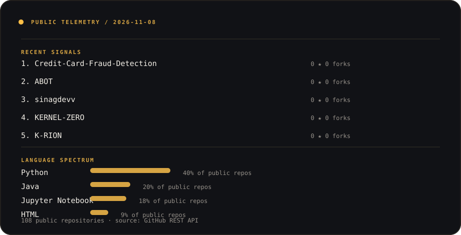

<p align="center">
  <a href="./site"></a>
</p>

<p align="center"><strong>Full-Stack Developer · AI Security · Cloud &amp; Automation</strong></p>

<p align="center">I’m John Ray Cacananta — a developer building useful software at the boundary of secure AI agents, retrieval systems, backend architecture, and automation.</p>

<p align="center"><a href="./site"><strong>↗ Explore the interactive SINAG experience</strong></a> &nbsp; · &nbsp; <a href="https://linkedin.com/in/jrcacananta">LinkedIn</a> &nbsp; · &nbsp; <a href="mailto:johnray.cacananta@gmail.com">Email</a></p>

<p align="center"><sub>SINAG /si·nag/ · Filipino: ray of light; sunray</sub></p>

<p align="center"></p>

## Signal

I work across the full path from system boundary to user-facing product:

| Focus | What I care about |
| --- | --- |
| AI agent security | Authorization, policy enforcement, governance, and inspectable tool use |
| Retrieval systems | Grounded answers, embeddings, vector search, and useful context |
| Full-stack architecture | Clear APIs, resilient data layers, responsive interfaces, and practical delivery |
| Cloud & automation | Event-driven workflows, deployment boundaries, and repeatable operations |

My home base is a **B.S. Information Technology** specialization in Mobile and Internet Technologies at National University - Fairview. I’m a consistent First Honor Dean’s Lister, 4.0 GPA, and Blue Scholar.

## Selected work

### DEVCON Kids Hub 2.0 · team lead / backend developer

Centralized operations for volunteer management, approvals, reporting, and AI-assisted knowledge retrieval. The technical focus is making operational handoffs traceable while keeping organizational knowledge useful.

[Repository](https://github.com/Debb1ie/DEVCON-Kids-Hub-2.0) · [Live system](https://devcon-kids-hub-2-0.vercel.app/)

### C.A.G.E. · causal authorization and governance engine

An AI-agent security framework for policy enforcement, causal reasoning, authorization decisions, and MCP security testing. Source is private; the public showcase is the intended boundary.

[Public showcase](https://cage-agent-security.vercel.app/)

### Bulldogs Xchange · full-stack campus marketplace

Reservations, inventory management, authentication, administrative workflows, and AI assistance in one campus workflow.

[Repository](https://github.com/sinagdevv/bulldogs-xchange) · [Live demo](https://bulldogs-xchange-live-demo.vercel.app/)

### MAT-AH · local-first file intelligence

AI-powered file intelligence and knowledge retrieval designed around a local-first workflow.

[Repository](https://github.com/Gabi-comm/MAT-AH) · [Showcase](https://mat-ah-showcase.vercel.app/)

### TripWise · field decision support

Fishermen safety and economic decision support with weather intelligence, risk assessment, and interactive maps.

[Repository](https://github.com/Alvin187187/TripWise) · [Live system](https://tripwise-sooty.vercel.app/)

### Mantika Check · explainable quality monitoring

Cooking-oil quality monitoring using explainable decision logic and mathematical degradation models.

[Repository](https://github.com/Gabi-comm/mantika-check) · [Live demo](https://mantika-check.vercel.app/)

## Current orbit

```text
AI agent security   ·   Model Context Protocol   ·   RAG systems
Authorization       ·   Backend architecture     ·   Cloud infrastructure
Data systems        ·   AI automation            ·   Responsible interfaces
```

## Working stack

<sub>Grouped by where I use them; not presented as equal mastery.</sub>

**Languages** · Python · Java · JavaScript · TypeScript · SQL · Bash · PowerShell<br />
**Frontend** · React · Next.js · Vite · Tailwind CSS · responsive interfaces<br />
**Backend &amp; data** · FastAPI · Node.js · Express · REST APIs · PostgreSQL · Supabase · SQLite · Firebase · pgvector<br />
**AI** · PyTorch · scikit-learn · embeddings · RAG · LLM integration · MCP<br />
**Cloud &amp; automation** · AWS · Azure · Docker · Vercel · GitHub Actions · n8n · Power Automate

<p align="center"></p>

## Public telemetry

<p align="center"></p>

<p align="center"><sub>Generated from public GitHub repository data by the daily workflow. It never includes private repository names or private activity.</sub></p>

## Experience

- **AI Automation Engineer Intern** · AgentGenius.ai / KeywordGenius · October 2026 — present<br />
  Shopify application development, Next.js, React, TypeScript, mobile responsiveness, APIs, MCP integration, and AI automation security.
- **Data Innovation Track Intern** · Eskwelabs · August 2026 — present<br />
  Synthetic data modeling, Python, dataset validation, and data workflows.
- **Machine Learning Intern** · FlyRank AI · June 2026 — October 2026<br />
  Applied machine learning, preprocessing, model evaluation, and NLP experimentation.

<p align="center"></p>

<p align="center"><sub>Interactive site source lives in <a href="./site">site/</a>. Deploy it independently after choosing a real Vercel URL.</sub></p>
