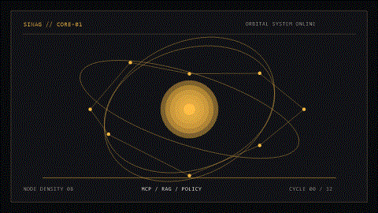
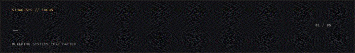
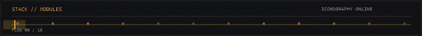

  

  

<strong>JOHN RAY CACANANTA</strong> <code>FULL-STACK DEVELOPER · AI SECURITY · CLOUD &amp; AUTOMATION</code>

  &nbsp;
  &nbsp;
  

## CAPABILITIES // STACK

  

  <strong><code>LANGUAGES</code></strong> 
  
  <code>SQL</code>

  <strong><code>FRONTEND</code></strong> 
  

  <strong><code>BACKEND</code></strong> 
  

  <strong><code>AI / ML</code></strong> 
  
  <code>OLLAMA</code>

  <strong><code>DATABASES</code></strong> 
  

  <strong><code>CLOUD / DEVOPS</code></strong> 
  

<strong><code>AUTOMATION</code></strong> <code>n8n</code>&nbsp; <code>POWER AUTOMATE</code>&nbsp; <code>API INTEGRATION</code>

<strong><code>AI SECURITY</code></strong> <code>MCP</code>&nbsp; <code>RAG</code>&nbsp; <code>AUTHORIZATION</code>&nbsp; <code>OPA</code>&nbsp; <code>REGO</code>&nbsp; <code>AGENT GOVERNANCE</code>

