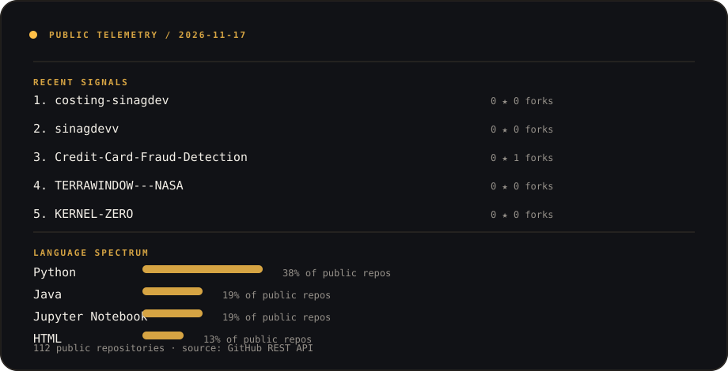
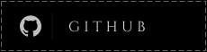

<h1 align="center"></h1>

<h2></h2>

**John Ray Cacananta** — Full-Stack Developer · AI Security · Cloud · Automation, based in Quezon City, Philippines.

Core belief: an agent should know what it's allowed to do before it does it.

<h2></h2>

- **AI agent security** — intent-based authorization, OPA/Rego, audit trails
- **Model Context Protocol** — wiring agents to tools safely
- **Full-stack builds** — Next.js · React · TypeScript · Supabase
- **Local-first AI** — Ollama, RAG, vector search
- **Automation** — n8n workflows, webhooks, agent orchestration

<h2></h2>

<h2></h2>

<h2></h2>

<h2></h2>

  &nbsp;
  &nbsp;
  

